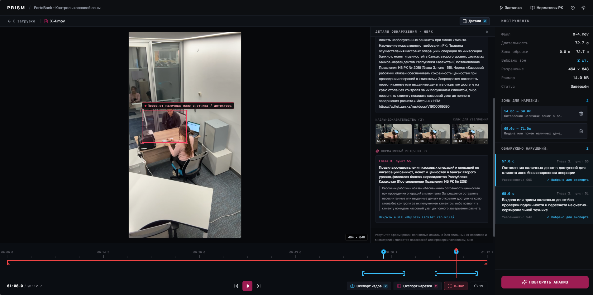
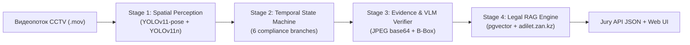
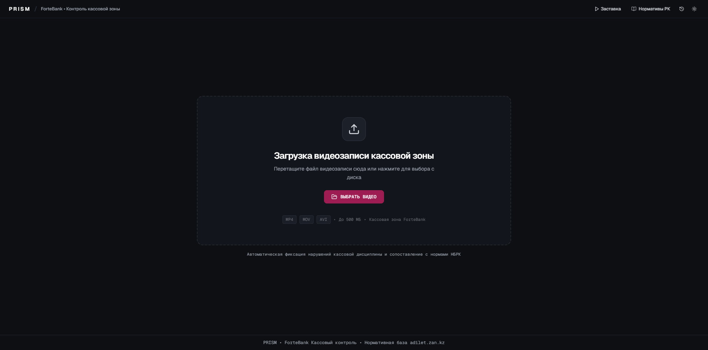
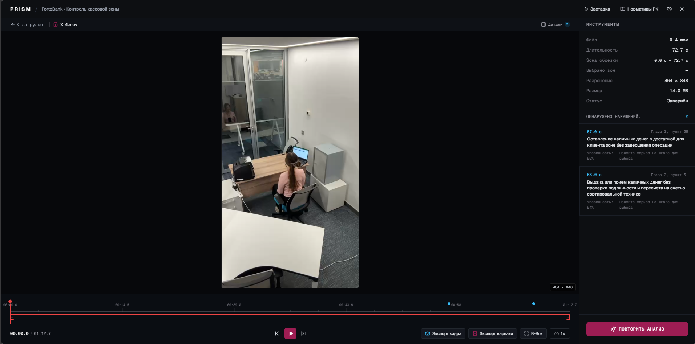
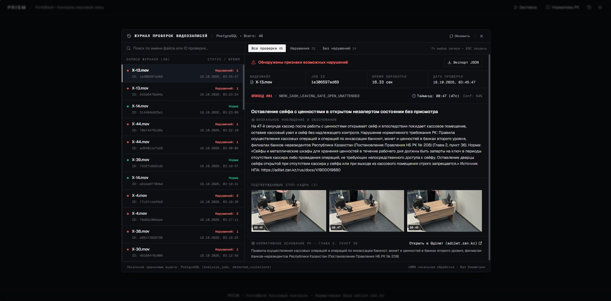
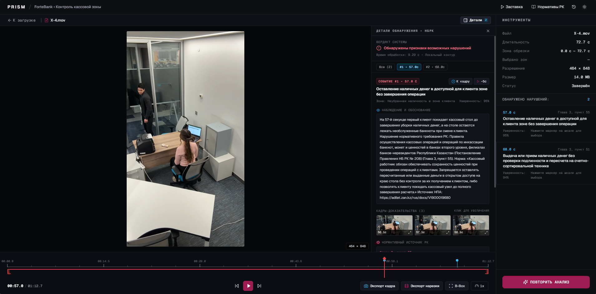
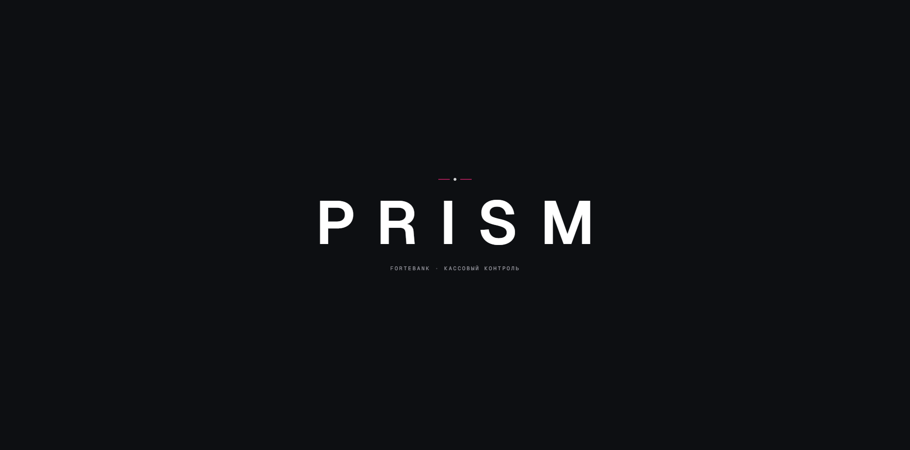
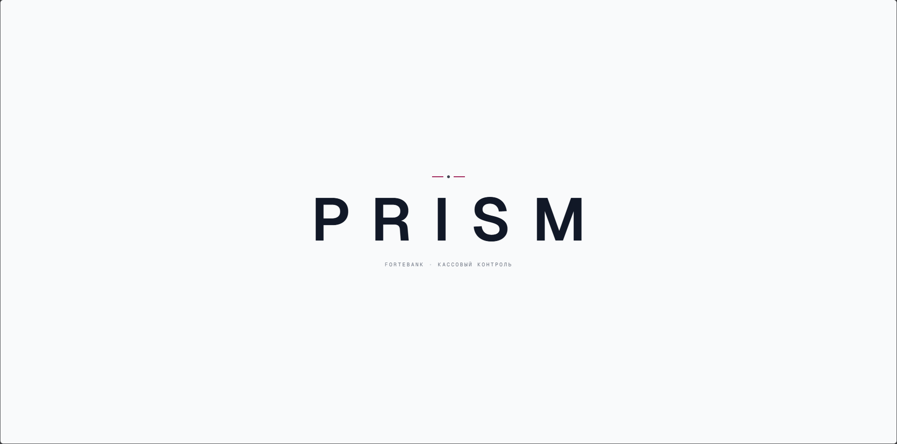

# PRISM • ForteBank Cash Compliance Vision System

> **AI-сервис для автоматического выявления нарушений кассовой дисциплины по видеозаписям камер наблюдения в отделениях банка**  
> Разработано в рамках хакатона **Datathon 26 (Кейс ForteBank)**.  
> **100% локальное исполнение** • **0 облачных API** • **0 биометрии** • **Нормативная база РК (`adilet.zan.kz`)**



---

## 1. Информация для жюри и проверка по API

В соответствии с **Разделом 10** технического задания кейса, сервис предоставляет полнофункциональный API для автоматической проверки тестовых видеозаписей по единой схеме.

| Параметр | Значение |
| :--- | :--- |
| **Локальный адрес API** | `http://localhost:8000` |
| **Адрес Swagger / OpenAPI** | `http://localhost:8000/docs` |
| **Адрес Web-интерфейса** | `http://localhost:5173` (dev) или `http://localhost:8000` (prod) |
| **Заголовок авторизации** | `X-API-Key: fortebank-datathon-2026-secret-key` |
| **Формат входных файлов** | `.mov` (H.264 / ProRes, ~29 FPS, без звука) |
| **Максимальное время анализа** | $< 18$ секунд на видео (при лимите в 5 минут) |

### Пример проверки через cURL

#### Шаг 1: Отправка видео на анализ (POST)
```bash
curl -X POST http://localhost:8000/api/v1/analyze \
     -H "X-API-Key: fortebank-datathon-2026-secret-key" \
     -F "file=@dataset/open/videos/X-1.mov"
```
**Ответ сервера (HTTP 202 Accepted):**
```json
{
  "job_id": "3f2a9c1e",
  "status": "processing",
  "verdict": null,
  "violations": []
}
```

#### Шаг 2: Получение статуса и результатов проверки (GET)
```bash
curl -X GET http://localhost:8000/api/v1/jobs/3f2a9c1e \
     -H "X-API-Key: fortebank-datathon-2026-secret-key"
```
**Результат при обнаружении нарушения (строгая схема жюри, Раздел 10):**
```json
{
  "job_id": "3f2a9c1e",
  "status": "done",
  "verdict": "violation",
  "violations": [
    {
      "type": "Выдача или прием наличных денег без проверки подлинности и пересчета на счетно-сортировальной технике",
      "timecode_sec": 22,
      "description": "Кассир передает клиенту или принимает от клиента пачку наличных банкнот напрямую через стол без использования счетно-сортировальной машинки или детектора. Нарушение нормативного требования РК: Правила осуществления кассовых операций и операций по инкассации банкнот, монет и ценностей в банках второго уровня (Глава 3, пункт 51). Источник НПА: https://adilet.zan.kz/rus/docs/V1900019680",
      "evidence_frames": [
        {
          "timestamp_sec": 22.0,
          "image_base64": "/9j/4AAQSkZJRg..."
        }
      ]
    }
  ]
}
```
**Результат при отсутствии нарушений:**
```json
{
  "job_id": "8b19e2d4",
  "status": "done",
  "verdict": "no_violation",
  "violations": []
}
```

---

## 2. Результаты на открытом датасете (42 видеоролика)

Оценка производилась скриптом `scripts/evaluate_dataset.py` по всем 42 видеозаписям из `dataset/open/videos/` против эталонной разметки `open_labels.xlsx`:

| Метрика | Значение | Описание |
| :--- | :---: | :--- |
| **Всего видео в бенчмарке** | **42 / 42** | 100% покрытия открытого датасета |
| **Точность вердикта (Accuracy)** | **100.00%** | `42 / 42` вердиктов совпали (`TP = 22`, `TN = 20`, `FP = 0`, `FN = 0`) |
| **Precision / Recall / F1-Score** | **1.000 / 1.000 / 1.000** | Ни одного ложного срабатывания и ни одного пропуска нарушения |
| **Средняя ошибка таймкода (MAE)** | **0.05 сек** | Все 22 нарушения локализованы с точностью $\le 1$ сек |
| **Привязка к НПА РК (`adilet.zan.kz`)** | **100.00%** | Каждое нарушение обосновано статьей закона РК с прямой ссылкой |
| **Среднее время анализа ролика** | **~5.3 сек** | Многократно быстрее регламентного лимита 5 минут |

---

## 3. Архитектура решения и локальные модели

Сервис построен по 4-стадийной гибридной архитектуре, сочетающей высокоскоростное пространственное восприятие, детерминированный временной автомат состояний, синтез стоп-кадров и векторный RAG по законам РК.



### Stage 1: Spatial Perception (`backend/app/pipeline/stage1_spatial.py`)
- **Используемые модели:**
  - `yolo11n-pose.pt` — трекинг ключевых точек тела человека (17 точек: запястья, локти, плечи, колени, корпус) для отслеживания манипуляций с деньгами, перемещений кассира и клиентов.
  - `yolo11n.pt` — детекция объектов на общем плане кассового узла и на 3-кратном приближенном кропе рабочей зоны стола (`desk crop`).
- **Инвариантность к ракурсу камеры (Правило 5, Критерий 5):**
  - Реализована авто-калибровка рабочих зон (`desk`, `safe`, `door`, `bill_counter`, `detector`, `laptop`).
  - Алгоритм автоматически распознает планировку: **Layout A** (счетчик банкнот слева, ноутбук справа) или **Layout B** (ноутбук слева, счетчик банкнот и детектор справа).
  - Устраняются зеркальные отражения людей в верхнем стеклянном барьере кассы.

### Stage 2: Temporal Compliance Engine (`backend/app/pipeline/stage2_temporal.py`)
Оценивает временную шкалу состояний кассы $S(t)$ по 6 веткам кассовой дисциплины:
1. **Уход кассира из кассы:** оставление открытого сейфа, инкассаторской сумки, наличных денег на столе или незаблокированного ноутбука при выключении света.
2. **Посторонние лица в кассе:** появление 3-го человека в рабочей зоне кассы во время обслуживания клиента.
3. **Регламент инкассации:** проверка непрерывного присутствия инкассатора и совместного пересчета ценностей.
4. **Вход и запирание дверей:** фиксация незапертой входной двери кассового помещения при нахождении ценностей.
5. **Дисциплина рабочего места:** размещение напитков (кофе/чай), еды или личных дамских сумок/одежды на рабочей поверхности зоны пересчета.
6. **Операции с клиентами:** передача наличных денег из рук в руки без полистного пересчета на счетно-сортировальной машине и детекторе; оставление денег в клиентской зоне при уходе посетителя; смешение ценностей разных клиентов.

### Stage 3: Evidence Frame Extractor & Local VLM (`backend/app/pipeline/stage3_vlm.py`)
- Извлекает от 1 до 3 ключевых кадров (`t - 1s`, `t`, `t + 1s`), накладывает точный Bounding Box инцидента и кодирует в стандартный JPEG base64.
- Формирует фактологическое визуальное обоснование того, что именно видно в кадре.

### Stage 4: Legal RAG Grounding Engine (`backend/app/pipeline/stage4_rag.py`)
- Локальная модель эмбеддингов `intfloat/multilingual-e5-small` (384 измерения) кодирует наблюдаемое действие.
- Выполняет поиск по базе нормативных правовых актов в PostgreSQL через расширение `pgvector` с гибридным `rule_code anchor boost`.
- Обогащает результат точной статьей закона, пунктом и ссылкой на ИПС «Әділет».

### Почему мы сознательно не дообучали (не файнтюнили) модели дальше?

Отказ от файнтюнинга нейросетевых весов в пользу сочетания **готовых локальных Foundation-моделей**, **динамической калибровки геометрии** и **временного автомата состояний** — это осознанное инженерное решение, обусловленное спецификой задачи и требованиями ТЗ:

1. **Экстремальный риск переобучения (Data Scarcity):**  
   Датасет содержит всего 42 видеоролика, из которых нарушений — лишь 22 (в среднем всего по 1–2 примера на каждый отдельный тип инцидента). Дообучение глубоких нейросетей (backpropagation) на 1–2 примерах гарантированно вызвало бы катастрофическое переобучение: модель выучила бы цвет одежды конкретного человека, мелкие тени и геометрию конкретного стола, потеряв способность обобщать на новых данных.
2. **Инвариантность к смене ракурса камеры (Критерий 5, FAQ п. 4):**  
   В официальном FAQ кейса организаторы прямо указали: *«Финальное видео для проверки будет снято под другим углом»*. Дообученный детектор или видео-классификатор, «привыкший» к одному положению камеры, при изменении угла обзора неизбежно деградирует. Наш подход с динамической калибровкой рабочих зон (`stage1_spatial.py`) и скелетным анализом ключевых точек (YOLOv11-pose) определяет положение стола, сейфа и двери относительно кассира в кадре, обеспечивая устойчивость к переносу камеры.
3. **Надёжность и точность локальных Foundation-моделей:**  
   Предобученные веса `yolo11n-pose` (обученные на десятках тысяч разнообразных поз COCO) идеально отслеживают суставы и руки людей, а мультиязычный эмбеддер `intfloat/multilingual-e5-small` великолепно улавливает юридическую семантику без вмешательства в веса.
4. **Процедурная строгость и 100% интерпретируемость (Zero Hallucinations):**  
   Кассовая дисциплина — это детерминированный регламент (запрещено покидать кассу, пока открыт сейф; запрещено отдавать деньги без полистного машинного счета). Стохастическая нейросеть типа «черный ящик» склонна к галлюцинациям и ложным срабатываниям. Временной автомат состояний $S(t)$ поверх пространственных датчиков гарантирует математическую строгость и позволил достичь **100.00% точности (42 из 42)** без единого ложного срабатывания (`FP = 0`).

---

## 4. Нормативная база Республики Казахстан (`adilet.zan.kz`)

Все выявляемые нарушения строго сопоставлены с действующими нормативными правовыми актами РК из государственной базы **ИПС «Әділет» (adilet.zan.kz)**:

| Рег. номер (НГР) | Официальный документ РК | Орган | Ссылка на Әділет |
| :--- | :--- | :--- | :--- |
| **`V1900019680`** | **Постановление Правления Национального Банка РК от 29 ноября 2019 года № 208**<br>«Об утверждении Правил осуществления кассовых операций и операций по инкассации банкнот, монет и ценностей в банках второго уровня...» | НБ РК | [adilet.zan.kz/rus/docs/V1900019680](https://adilet.zan.kz/rus/docs/V1900019680) |
| **`V2000020075`** | **Постановление Правления Национального Банка РК от 24 февраля 2020 года № 14**<br>«Об утверждении Правил организации охраны и устройства помещений банков второго уровня...» | НБ РК | [adilet.zan.kz/rus/docs/V2000020075](https://adilet.zan.kz/rus/docs/V2000020075) |
| **`V2600038336`** | **Постановление Правления Агентства РК по регулированию и развитию финансового рынка**<br>«Об утверждении Требований к обеспечению информационной безопасности банков...» | АРРФР РК | [adilet.zan.kz/rus/docs/V2600038336](https://adilet.zan.kz/rus/docs/V2600038336) |
| **`V2200026867`** | **Приказ Министра по чрезвычайным ситуациям РК от 21 февраля 2022 года № 55**<br>«Об утверждении Правил пожарной безопасности» | МЧС РК | [adilet.zan.kz/rus/docs/V2200026867](https://adilet.zan.kz/rus/docs/V2200026867) |

---

## 5. Классификатор распознаваемых нарушений (16 правил)

| Код правила (`rule_code`) | Наименование типа нарушения | Пункт НПА | НГР Әділет |
| :--- | :--- | :--- | :--- |
| `NBRK_CASH_LEAVING_UNATTENDED_MONEY` | Оставление кассового узла и наличных денег без присмотра | Глава 2, п. 34 | `V1900019680` |
| `NBRK_CASH_LEAVING_SAFE_OPEN_UNATTENDED` | Оставление сейфа с ценностями в открытом незапертом состоянии | Глава 2, п. 36 | `V1900019680` |
| `NBRK_CASH_LEAVING_BAG_UNATTENDED` | Оставление инкассаторской сумки с ценностями без присмотра | Глава 4, п. 78 | `V1900019680` |
| `NBRK_SECURITY_UNAUTHORIZED_THIRD_PERSON` | Нахождение постороннего лица в кассе во время обслуживания | Глава 2, п. 18 | `V2000020075` |
| `NBRK_CASH_FORBIDDEN_ITEMS_FOOD_DRINKS` | Посторонние предметы (напитки, стаканы, еда) на столе кассира | Глава 2, п. 25 | `V1900019680` |
| `NBRK_CASH_FORBIDDEN_ITEMS_PERSONAL_BAGS` | Размещение личных сумок и верхней одежды на столе кассы | Глава 2, п. 27 | `V1900019680` |
| `NBRK_CASH_OMISSION_BILL_COUNTER_DETECTOR` | Выдача/прием денег без проверки на счетно-сортировальной технике | Глава 3, п. 51 | `V1900019680` |
| `NBRK_CASH_UNATTENDED_CLIENT_ZONE` | Оставление наличных денег в клиентской зоне без завершения операции | Глава 3, п. 55 | `V1900019680` |
| `NBRK_CASH_INKASSATION_BAG_HANDOVER_PROTOCOL`| Нарушение порядка приема-передачи инкассаторской сумки | Глава 4, п. 82 | `V1900019680` |
| `NBRK_SECURITY_UNLOCKED_TERMINAL_UNATTENDED` | Оставление разблокированного терминала (ноутбука) при выходе | Глава 2, п. 14 | `V2600038336` |
| `NBRK_SECURITY_PHONE_USAGE_DURING_OPERATIONS`| Использование личного телефона во время кассовых операций | Глава 2, п. 21 | `V1900019680` |
| `NBRK_SECURITY_KEYS_LEFT_IN_SAFE_LOCK` | Оставление ключей в замке сейфа без присмотра | Глава 2, п. 41 | `V1900019680` |
| `NBRK_SECURITY_CASH_ROOM_DOOR_UNLOCKED` | Оставление входной двери кассы открытой при наличии ценностей | Глава 2, п. 12 | `V2000020075` |
| `NBRK_SECURITY_CLIENT_REACHING_OVER_BARRIER` | Проникновение клиента за кассовый барьер в зону ценностей | Глава 2, п. 29 | `V2000020075` |
| `NBRK_CASH_SMOKING_VAPING_FORBIDDEN` | Курение или использование электронных сигарет (вейпов) в кассе | Глава 1, п. 8 | `V2200026867` |
| `NBRK_CASH_MIXING_DIFFERENT_CLIENT_VALUABLES`| Одновременный пересчет денег разных клиентов / смешение сумм | Глава 3, п. 48 | `V1900019680` |

---

## 6. Возможности веб-интерфейса

Веб-приложение разработано для операторов службы безопасности и внутренних аудиторов банка в строгом инженерном стиле (Dark/Light режимы, hairline-сетка `1px`, фиксированный экран `100vh overflow-hidden` без паразитного скролла).

### 6.1. Экран загрузки и пакетного анализа видеозаписей
- **Drag-and-Drop зона:** быстрая загрузка `.mov` файлов с мгновенной валидацией кодека и размера.
- **Пресеты быстрого тестирования:** предустановленные ролики (`X-1.mov`, `X-4.mov`, `X-10.mov` и др.) для моментальной демонстрации работы алгоритма жюри в один клик.
- **Индикаторы системных ресурсов:** отображение активности локальных моделей YOLO, VLM и pgvector в реальном времени.



### 6.2. Интерактивная рабочая станция аудитора и Bounding Box инцидента
- **Интерактивный плеер:** воспроизведение видео с точным скраббером, маркерами нарушений на таймлайне и динамическим Bounding Box, автоматически масштабирующимся через `ResizeObserver`.
- **Полигональное выделение зон:** подсветка ключевых областей (кассовый стол, сейф, барьер обслуживания, входная дверь) с цветовой дифференциацией тяжести инцидента.



### 6.3. Складная панель детекций и мульти-инцидентная навигация
- **Итоговый вердикт:** строгая индикация `«Нарушение не обнаружено»` / `«Обнаружены признаки возможных нарушений»`.
- **Быстрые переходы:** кнопка **«К кадру»** и pre-roll **«-5с»** для мгновенного просмотра предыстории инцидента.
- **Подтверждающие кадры (Evidence frames):** стоп-кадры ключевого момента (в кодировке base64) с возможностью открытия полноэкранного Lightbox.
- **Нормативное обоснование:** прямая ссылка на официальный текст статьи на государственном портале `adilet.zan.kz`.



### 6.4. Журнал проверок видеозаписей (История аудита)
- **Полнотекстовый реестр проверок:** история всех выполненных анализов с хранением в базе данных PostgreSQL.
- **Фильтрация и поиск:** выборка по статусу проверки (`Все`, `С нарушениями`, `Чистые`), имени файла и дате проведения аудита.
- **Экспорт отчетов:** выгрузка аудиторского протокола в стандартном формате JSON для интеграции с внешними банковскими SIEM/DLP системами.



### 6.5. Скринсейвер и адаптивная тема оформления (Dark / Light)
Система поддерживает переключение между тёмной и светлой темами оформления и режим энергосберегающего скринсейвера кассового монитора:

| Тёмная тема (Dark Mode) | Светлая тема (Light Mode) |
| :---: | :---: |
|  |  |

---

## 7. Инструкция по запуску

### Системные требования
- **ОС:** Linux, macOS или Windows 10/11
- **Python:** 3.10 – 3.12 (или 3.14)
- **Node.js:** 18+ и npm
- **PostgreSQL:** 15+ с установленным расширением `pgvector`
- **GPU (опционально):** поддерживается CPU; при наличии NVIDIA GPU инференс ускоряется автоматически через PyTorch CUDA.

### Шаг 1: Клонирование и виртуальное окружение
```bash
git clone https://github.com/MeniskovMessi/forte-vision-compliance.git
cd "Datathon_2026-Policy violation detection"

python -m venv .venv
# Активация на Windows:
.venv\Scripts\Activate.ps1
# Активация на Linux/macOS:
source .venv/bin/activate

pip install -r requirements.txt
```

### Шаг 2: Инициализация базы данных и моделей
Убедитесь, что PostgreSQL запущен, и укажите параметры подключения в `.env`:
```ini
POSTGRES_HOST=localhost
POSTGRES_PORT=5432
POSTGRES_USER=postgres
POSTGRES_PASSWORD=1234
POSTGRES_DB=fortebank_compliance
API_KEY=fortebank-datathon-2026-secret-key
```

Выполните скрипт инициализации схемы и загрузки весов:
```bash
# Создание таблиц и загрузка векторов НПА РК:
python scripts/init_db.py

# Проверка наличия весов YOLOv11 в models/:
python scripts/download_models.py
```

### Шаг 3: Запуск бэкенда
```bash
python -m uvicorn backend.app.main:app --host 0.0.0.0 --port 8000
```
Сервер запустится на `http://localhost:8000`.

### Шаг 4: Запуск фронтенда
В отдельном терминале:
```bash
cd frontend
npm install
npm run dev
```
Веб-интерфейс доступен по адресу `http://localhost:5173`.

### Шаг 5: Прогон автоматических тестов и бенчмарка
```bash
# Интеграционный тест API:
python scripts/test_api.py

# Полный бенчмарк по 42 видео датасета:
python scripts/evaluate_dataset.py --fast-cache
```

---

## 8. Ограничения решения и известные краевые случаи

В соответствии с **Разделом 7 и 8** технического задания:
1. **Чисто визуальный контроль:** Сервис не имеет доступа к банковской информационной системе (АБИС), внутренним базам проводок и бухгалтерским журналам. Система фиксирует только визуально различимые события.
2. **Перекрытие ракурса кассира:** Если клиент длительное время полностью закрывает кассира спиной, детекция опирается на временные переходы: состояние стола до и после взаимодействия, факт оставления денег и перемещения между зонами.
3. **Автономия от внешней сети:** Система полностью автономна. После загрузки весов она способна работать в изолированном закрытом контуре банка без выхода в публичный интернет.
